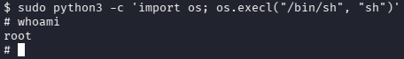

| Plataforma          | Docker Labs |
| ------------------- | ----------- |
| Dificultad          | Fácil       |
| IP de la Máquina    | 172.17.0.2  |
| Fecha de resolución | 03/10/2026  |

---
# 📑 WRITEUP: PEQUEÑAS-MENTIROSAS

> ℹ️ ****RESUMEN****
> - **IP Objetivo:** `172.17.0.2`
> - **Sistema Operativo:** Linux 🐧
> - **Descripción:** El reto se centra en la explotación de una vulnerabilidad conocida en un servicio web. Posteriormente, se realiza una escalada de privilegios mediante la identificación y explotación de configuraciones inseguras, lo que permite al atacante obtener acceso root.🔑
> - **Privilegios Obtenidos:** `root` 👑

---

## 🎯 FASE 1: RECONOCIMIENTO Y ENUMERACIÓN

### 💻 Conectividad Inicial
Determinamos el Sistema Operativo analizando el Time To Live (TTL) mediante un paquete ICMP:
```bash
ping -c 1 172.17.0.2
```


* **Diagnóstico:** TTL = `64`. Confirmamos directamente que el host objetivo es un sistema **Linux**.

### 🔍 Mapeo de Puertos y Servicios
Lanzamos un escaneo con **Nmap** para mapear los puertos abiertos y descubrir sus servicios.


| Puerto   | Servicio | Versión Detectada   | Estado / Nota                                    |
| :------- | :------- | :------------------ | :----------------------------------------------- |
| `22/TCP` | SSH      | OpenSSH 9.2p1       | 🔐 Vector de Acceso (Fuerza Bruta Dirigida)      |
| `80/TCP` | HTTP     | Apache httpd 2.4.62 | 🌐 Servidor Web Activo (Fuzzing / Fuga de datos) |

#### Comandos de Nmap utilizados:
```bash
sudo nmap -p- -sS -sV --min-rate 5000 -n -Pn --open 172.17.0.2
```

---

## ⚡ FASE 2: EXPLOTACIÓN (ACCESO INICIAL)

### 🌐 Auditoría Web y Descubrimiento
Al explorar el servicio HTTP (`http://172.17.0.2`), este no tiene diseño ni contenido: solo un mensaje, el cual obtendremos con `curl`


> 💡 **Extracción de Credenciales / Pistas**
> Entendemos que A puede referir a un posible usuario, por lo cual supondremos que `a` es un usuario y tendremos que realizar un ataque por SSH de fuerza bruta

### 🔑 Ataque de Fuerza Bruta Dirigido (SSH)
Con los nombres de usuario válidos recolectados de la fase de descubrimiento web, se ejecuta un ataque por diccionario utilizando **Hydra** contra el puerto 22 recurriendo a `rockyou.txt` o una wordlist personalizada filtrada:

```bash
hydra -l a -P /usr/share/wordlists/rockyou.txt ssh://172.17.0.2
```


> ✅ ****Credenciales Iniciales Halladas****
> - **Usuario:** `a`
> - **Contraseña:** `secret`

Establecemos la sesión formal en el contenedor por medio del cliente SSH:
```bash
ssh a@172.17.0.2
```


---

## 👑 FASE 3: ESCALADA DE PRIVILEGIOS

Una vez dentro, vemos que no tenemos permisos de sudo por lo cual tendremos que buscar otros usuarios que tengan permisos para seguir escalando privilegios:

```
cat /etc/passwd | grep "/bin/bash"
```


> ✅ **Usuario encontrado**
> Conseguimos identificar al usuario `spencer` por lo cual podemos realizar otro ataque mediante Hydra para poder conseguir las credenciales y continuar la escalada .


Con las credenciales `spencer` y `password1` pivotamos de usuario, logramos acceder con las credenciales obtenidas y revisamos nuevamente los permisos `sudo` para encontrar:


---
### ⚔️ ESCALADA A ROOT
Abusamos de las funciones nativas o escapes permitidos del binario (siguiendo las metodologías documentadas en GTFOBins). En este caso podemos ejecutar /usr/bin/python3 tal que:

```bash
sudo python3 -c 'import os; os.execl("/bin/sh", "sh")'
```

Comprobamos que hayamos tomado el control total del contenedor:
```bash
whoami
```



```bash
# Output directo de la terminal comprometida:
root
```

> ✅ ****MÁQUINA COMPLETADA****
> Compromiso total consolidado con éxito. Logramos escalar a **`root`** explotando las malas configuraciones en los permisos del sistema tras un análisis inteligente del entorno web.

---

## 🛠️ FASE 5: VULNERABILIDADES Y MITIGACIONES 

CWE-269 Crítico

>Gestión Inadecuada de Privilegios. Ya dentro de la maquina comprometida con un usuario inicial, el comando sudo -l nos informa sobre la posibilidad de obtener permisos de forma excesiva. 

Mitigación

>Aplicar el principio de mínimo privilegio para sudoers
>Evitar otorgar permisos NOPASSWD a comandos de utilidad o editores de texto que cuenten con funciones nativas de escape a la shell


CWE-307 Crítico

>Una vez obtenido el usuario desde la web, el servicio SSH permite realizar un número indefinido de solicitudes de autenticación sin bloquear las conexiones, facilitando el acceso con ataques automáticos (En este caso, el uso de Hydra para la obtención de credenciales)

Mitigación

>Utilizar herramientas como Fail2Ban para banear temporal o permanentemente las direcciones IP que superen una cierta cantidad de intentos fallidos al momento de intentar forzar el ingreso.

CWE-200 Alto

>Mediante el escaneo de la web, se localizan recursos o cadenas de texto ocultas que se pueden interpretar como pistas o posibles vectores de ataque por los cuales extraer información. En este caso, el servicio web actúa como un repositorio inseguro al dejar accesibles archivos que contienen información crucial para la obtención de credenciales.

Mitigación

>Remover cualquier archivo de texto, comentarios HTML o scripts dentro del código fuente de la web

